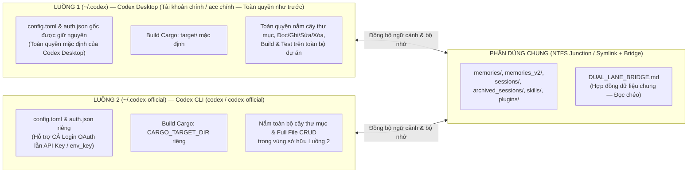

# Codex Dual-Lane & Security Kit (Windows / macOS / Linux / WSL)

> **Tác giả:** **Lê Hoàng Ngọc Tươi** | **Giấy phép:** Apache License 2.0 ([LICENSE](LICENSE) · [NOTICE](NOTICE))  
> **Bộ công cụ cài đặt 1 chạm, tự thích nghi cấu hình từng máy** giúp chạy song song **2 luồng OpenAI Codex độc lập** — tách tài khoản/API key, dùng chung bộ nhớ & lịch sử, **cách ly chỉ phân tích tĩnh (`Static-Analysis-Only`) & mặc định khóa mạng shell sandbox**, tương thích cả máy **1 ổ đĩa (`C:\`) lẫn nhiều ổ đĩa**, tự dò mọi kiểu cài đặt Codex (`WindowsApps`, `npm`, standalone), **không hardcode model/tier, không mock data, không chứa API key**.

---

## Bạn thuộc trường hợp nào? (Chọn đúng kịch bản của bạn)

| Trường hợp của bạn | Vấn đề bạn đang gặp | Bộ kit này giải quyết thế nào? |
| :--- | :--- | :--- |
| **1. Dùng Codex Desktop cho tài khoản chính (`acc chính`, giữ toàn quyền như trước, không đụng 1 byte cấu hình) và muốn Codex CLI vừa kế thừa tài nguyên vừa hỗ trợ cả Login lẫn API Key** | Muốn giữ **Codex Desktop (`~/.codex`)** cố định ở **tài khoản chính (`acc chính`)** với **toàn quyền như trước** (tuyệt đối không sửa `~/.codex/config.toml` hay `auth.json`), chỉ **tận dụng khai thác chỉ-đọc (read-only harvest)** danh sách dự án đã `trusted`, bộ nhớ, lịch sử và (tùy chọn) phiên đăng nhập sang **Codex CLI (`~/.codex-official`)** để CLI chạy linh hoạt cả **OAuth Login lẫn API Key / Gateway**. | Tách 2 `CODEX_HOME` độc lập: **Luồng 1 (`~/.codex` — Codex Desktop / Tài khoản chính `acc chính`, giữ nguyên 100% `config.toml` & `auth.json` không đụng 1 byte)** và **Luồng 2 (`~/.codex-official` — Codex CLI `codex` / `codex-official`, tự động kế thừa chỉ-đọc `[projects."..."]` đã `trusted` từ Desktop, dùng chung `memories`/`sessions`/`skills`/`plugins`, hỗ trợ `-ShareAuthToLane2` / `--share-auth-to-lane2` và cấu hình 1 cờ `-ConfigureCliGateway` / `--configure-cli-gateway` + `-CliApiKeyEnv` / `--cli-api-key-env`)**. |
| **2. Muốn chạy 2 agent song song trên cùng 1 dự án mà vẫn hiểu nhau** | Ví dụ: Luồng 1 làm Backend/Binary trên Desktop, Luồng 2 làm SAST/Frontend/CLI trên Terminal. Chạy chung thì đè file nhau; tách riêng thì không hiểu bên kia đang làm gì. | Nối **NTFS Directory Junction** (Windows) / **symlink** (macOS/Linux) cho `memories`, `sessions`, `skills`, `plugins` + cơ chế **Ghi riêng – Đọc chung** qua `DUAL_LANE_BRIDGE.md` *(ranh giới mềm qua prompt)* hoặc thêm cờ **`-UseGitWorktree`** / **`--use-git-worktree`** *(ranh giới cứng cưỡng chế ở cấp OS sandbox qua worktree riêng)*. |
| **3. Cần agent nắm toàn bộ cây thư mục và tự do đọc/ghi/sửa/xóa file code mà vẫn chặn tuyệt đối lệnh phá hoại & mã độc** | Sợ bật bảo mật quá chặt làm agent không đọc được cây thư mục hoặc không tạo/sửa/xóa được file dự án, nhưng mở toang lại sợ lệnh phá hệ thống, sửa ACL hay chạy nhầm file mẫu lỗ hổng. | Kết hợp `sandbox_mode = "workspace-write"` + tường lửa `default.rules` + `AGENTS.md`: cho phép agent **tự do 100% nắm bắt toàn bộ cây thư mục** (`rg --files`, `git status`, `Get-ChildItem`, `find`) và **đọc, tạo, sửa, di chuyển, xóa file** trong workspace dự án, trong khi chặn cứng (`forbidden`) lệnh ransomware/hệ thống/ACL và khóa **`Static-Analysis-Only`** (chỉ cấm thực thi file mẫu/payload bên thứ 3, không bao giờ cản trở thao tác sửa/xóa code bình thường). |
| **4. Máy chỉ có 1 ổ `C:\`, cấu hình khác nhau hoặc dùng Codex bản `npm`/standalone** | Các script cứng đường dẫn `D:\`, `E:\` hay ghi đè mất cấu hình cũ trong `config.toml` sẽ lỗi trên máy khác. | Tự dò thực tế mọi nguồn cài đặt (`WindowsApps`, `PATH`, `npm`, `-CodexPath`), tự dò feature flags bằng `codex features list`, **merge `config.toml` không phá hủy** (giữ nguyên `[mcp_servers]`, `[tui]`, `[plugins]` cũ), tự kiểm tra ổ đĩa NTFS & dung lượng trống. |
| **5. Dự án Rust bị kẹt `Blocking waiting for file lock` khi 2 agent cùng test** | Hai agent cùng chạy `cargo test` tranh nhau khóa `target/.cargo-lock`. | Tự tách `CARGO_TARGET_DIR` riêng cho Luồng 2 (mặc định `%TEMP%\codex-lane2-target` trên Windows hoặc `${TMPDIR:-/tmp}/codex-lane2-target` trên Unix, tùy chỉnh qua `-CargoTargetDir` / `CODEX_CARGO_TARGET_DIR`) $\rightarrow$ biên dịch song song không khóa nhau. |
| **6. Dùng CLI từ Windows Desktop gặp lỗi `--no-daemon`, mất task ghim (`Pinned`), hoặc lo rủi ro lộ API key** | Báo lỗi `this CLI has no complete local package`, mất danh sách `Pinned` khi DB mới chưa có dòng `threads`, hoặc lộ API key trong `config.toml`. | Tự động tắt `daemon_auto_start = false` khi có hỗ trợ, kèm `sync-sessions.py` thực hiện **UPSERT (`INSERT` + `UPDATE`)** theo schema động (đọc nguồn chỉ-đọc `?mode=ro`), dùng `env_key` để **không bao giờ lưu plaintext API key vào `config.toml`**, mặc định `approval_policy = "on-request"`, và phòng thủ 4 lớp (`workspace-write` + `network_access = false`, lọc `*KEY*/*TOKEN*` & khóa ACL/chmod, `default.rules`, `AGENTS.md`). |

---

## Kiến trúc "2 Luồng – 1 Bộ Não Chung"



---

## Đảm bảo tương thích thực tế & Ranh giới Bảo mật Minh bạch

* **Tương thích mọi bố cục ổ đĩa:** Hoạt động mượt trên cả laptop **chỉ có 1 ổ `C:\`** lẫn PC nhiều ổ (`C:\`, `D:\`, `E:\`). Tự động kiểm tra định dạng NTFS và báo cảnh báo nếu ổ build còn dưới 10 GB trống (cho phép chỉ định `-CargoTargetDir` sang bất kỳ ổ nào).
* **Tương thích mọi cách cài đặt Codex & mọi Shell (PowerShell / CMD / Git Bash / MSYS2 / WSL / Unix):** Tự dò theo thứ tự: `-CodexPath` $\rightarrow$ `WindowsApps` (`OpenAI.Codex`) $\rightarrow$ `PATH` *(tự loại trừ wrapper của chính nó để tránh lặp vô hạn)* $\rightarrow$ `%APPDATA%\npm\codex.cmd` / `%LOCALAPPDATA%\Programs\Codex\codex.exe`. Trên Windows, bộ cài sinh đồng thời cả bộ `.cmd` (`codex.cmd`, `codex-official.cmd`, `codex-t3.cmd`) lẫn POSIX shim không đuôi (`codex`, `codex-official`, `codex-t3` chuẩn LF) trong `~/.local/bin` giúp gõ `codex` chạy mượt ngay trong **Git Bash / MSYS2 / PowerShell / CMD**, đồng thời hỗ trợ truyền đường dẫn tương đối (`-RepoPath .` / `--repo-path .`).
* **Tương thích mọi phiên bản Codex & mọi gói tài khoản:**
  * Không hardcode model hay `service_tier` vào `config.toml` trừ khi bạn truyền `-OfficialModel` / `-OfficialServiceTier` — tránh lỗi trên tài khoản không có model đó.
  * Tự chạy `codex features list` thật để chỉ bật các flag mà phiên bản Codex trên máy bạn thực sự hỗ trợ.
  * `sync-sessions.py` tự dò tệp `state_*.sqlite` và `goals_*.sqlite` mới nhất + đọc cột thật qua `PRAGMA table_info`, tương thích ngược/xuôi khi Codex nâng cấp database.
* **Khai thác Chỉ-đọc (Zero-Intrusion Read-Only Harvesting) từ Codex Desktop (`~/.codex`, Luồng 1) & Toàn quyền Nắm bắt Cây Thư mục / Thao tác File CRUD trong Workspace (v1.3.2):** Mặc định (và khi dùng `-ConfigureCliGateway` / `-GatewayTargetLane Lane2` hoặc `--configure-cli-gateway` / `--gateway-target-lane lane2`), tệp `~/.codex/config.toml` và `~/.codex/auth.json` của **Codex Desktop (Tài khoản chính / `acc chính`) được giữ nguyên 100% không chạm 1 byte**, đồng thời bộ cài chỉ **đọc chỉ-đọc (`read-only`)** `~/.codex/config.toml` để kế thừa toàn bộ danh sách `[projects."..."]` đã `trusted` sang `~/.codex-official/config.toml` (kèm tùy chọn `-ShareAuthToLane2` / `--share-auth-to-lane2` để sao chép nguyên tử `auth.json` sang Luồng 2 với khóa ACL / `chmod 600` mà vẫn giữ `~/.codex/auth.json` nguyên vẹn 100%). Ngay cả khi cấu hình `-ConfigureGateway` cho `Lane1` hoặc `Both`, bộ kit cũng không bao giờ ép `sandbox_mode` hạn chế hay `network_access = false` vào `~/.codex/config.toml`, đảm bảo Codex Desktop giữ **toàn quyền như trước** trên toàn bộ dự án (chỉ phân chia phạm vi thư mục nếu bạn chủ động khai báo nhiệm vụ chia đôi trong `DUAL_LANE_BRIDGE.md`). Đồng thời trên cả 2 luồng, bên trong thư mục dự án (`workspace-write`), agent hoàn toàn tự do duyệt và nắm toàn bộ cây thư mục (`rg --files`, `git status`, `Get-ChildItem`, `find`) cũng như **đọc, ghi, tạo mới, chỉnh sửa, di chuyển, xóa file dự án, build và chạy test** (`apply_patch`, `Set-Content`, `Remove-Item`, `rm`, `mv`, `cp`, `mkdir`). Các lớp khóa chỉ chặn lệnh phá hủy hệ thống/ransomware/sửa ACL (`vssadmin`, `bcdedit`, `icacls`, `schtasks`), chặn thoát ra ngoài workspace và áp dụng `Static-Analysis-Only` đối với việc **thực thi/kích nổ file mẫu mã độc hoặc payload bên thứ 3**.
* **An toàn tuyệt đối khi chạy thử, ngắt giữa chừng & khôi phục (v1.3.2):** Luôn sao lưu bản gốc có dấu thời gian (`.backup-yyyyMMdd-HHmmss`) kèm **nhật ký rollback tăng dần chống crash (Crash-Safe Incremental Rollback Journal)** (`.rollback/latest.json` với `Completed: false -> true` trên Windows / `.rollback/latest.tsv` với `# status=in-progress -> complete` trên Unix) được ghi nguyên tử ngay sau từng thay đổi. Đặc biệt từ v1.3.1–v1.3.2, rollback ghi nhận chính xác quyền sở hữu (`SharedLinkRecords` / `L` rows) và toàn bộ launcher (`.cmd` + POSIX shim không đuôi): **bảo toàn nguyên vẹn symlink/Junction có từ trước của người dùng** (chỉ gỡ liên kết do kit tạo ra), **khôi phục thư mục từ đúng đường dẫn sao lưu ghi trong manifest** (không đoán mò theo sắp xếp tên wildcard `.backup-*`), và **kiểm tra tiền trạm (preflight) fail-closed nghiêm ngặt** (nếu thiếu bản sao lưu và đích chưa ở trạng thái gốc, script lập tức dừng với mã lỗi `1` trước khi gỡ bất kỳ Junction nào hay đụng vào ổ đĩa). Ngay cả khi cài đặt bị ngắt giữa chừng (`Ctrl+C`/lỗi), `restore-original.ps1` / `restore-original.sh` vẫn khôi phục chính xác từng byte (SHA-256 + chế độ POSIX trên Unix), bảo toàn launcher cũ chưa kịp chạm tới và không làm mất dữ liệu Luồng 1. Luôn giữ lại toàn bộ `[projects]` đã `trusted` và các mục `[mcp_servers.*]`/`[tui]`/`[plugins.*]`, hỗ trợ **`-DryRun`** / **`-WhatIf`** (Windows) và **`--dry-run`** (Unix) không sửa 1 byte nào trên đĩa, và đã kiểm chứng qua **vòng lặp cài đặt + khôi phục 3 lần liên tiếp** với 0 tệp rác.
* **Chuẩn hóa đường dẫn 8.3 ngắn trên Windows (`RUNNER~1` / `PROGRA~1`):** Toàn bộ script PowerShell, wrapper `.cmd` sinh ra (so khớp đồng thời đường dẫn dài chuẩn và `%%~fs`) và bộ test đều chuẩn hóa bằng Win32 `GetLongPathNameW`, đảm bảo định tuyến worktree, chặn `-C`/`--cd`/`--add-dir` và kiểm tra containment luôn khớp nhất quán khi `%TEMP%` hoặc `cwd` dùng tên ngắn 8.3 (vd trên Windows CI `RUNNER~1`).
* **Minh bạch giới hạn OS / Codex runtime (đọc kỹ [docs/SECURITY_MODEL.md](docs/SECURITY_MODEL.md)):**
  * **Windows NTFS ACL & giới hạn không thể chặn từ bên ngoài khi Codex tự ghi đè file:** Thư mục `~/.codex*` trên Windows có thể mang quyền kế thừa `CodexSandboxUsers:(OI)(CI)(RX)`. Bộ cài chạy quy trình **`icacls.exe` 2 bước fail-closed** (`/inheritance:d` rồi `/remove:g "CodexSandboxUsers"`) lên `auth.json`, `config.toml`, bản sao lưu và manifest `.rollback/` (đã kiểm chứng thực tế trên `codex-cli 0.171.0-alpha.13` với Win32 `AuthzAccessCheck`: quyền đọc của danh tính elevated `CodexSandboxOffline` chuyển từ `Error=0` sang `Error=5 [ERROR_ACCESS_DENIED]`). Tuy nhiên, **script bên ngoài không thể ngăn chính Codex CLI/Desktop** khi nó ghi lại `config.toml` (đã xác nhận thực nghiệm với `codex features enable/disable`: `AreAccessRulesProtected` bị reset về `False` và `CodexSandboxUsers:(RX)` quay lại cho tới khi chạy `setup-dual-lane.ps1 -ReapplyAclOnly`), đồng thời backend Windows sandbox không nâng quyền (unelevated write-restricted token) khóa ghi cứng nhưng vẫn chạy dưới SID của user hiện tại nên không chặn được thao tác đọc tệp thuộc chính user. Hãy chạy `-ReapplyAclOnly` + `doctor.ps1` sau mỗi lần đổi Settings Codex.
  * **Khuyến nghị vệ sinh secret mạnh nhất:** Kết hợp **`cli_auth_credentials_store = "keyring"`** (khi phiên bản Codex của bạn hỗ trợ) để lưu OAuth token trong OS Keyring thay vì `auth.json` dạng văn bản, cùng **`env_key`** (không bao giờ lưu plaintext API key trong `config.toml`) để ngay cả khi DACL của `config.toml` bị reset hoặc chạy ở chế độ sandbox không nâng quyền cũng không lộ khóa.
  * **Ranh giới `execpolicy`, Hard Fail-Closed Worktree & phạm vi CI vs. Codex thật:**
    * `default.rules` kiểm khớp tiền tố lệnh trực tiếp (`argv[0]`, đã kiểm chứng sống **13/13** probe trên `codex-cli 0.171.0-alpha.13`), không phân tích hết chuỗi lồng trong `powershell -Command "..."` — vì vậy luôn giữ đủ 4 lớp phòng thủ.
    * Khi dùng `-UseGitWorktree` / `--use-git-worktree`, wrapper Luồng 2 (`codex`, `codex-official`) cưỡng chế **ranh giới worktree fail-closed cứng**: tự động chuyển `cwd` từ thư mục gốc dự án **và mọi thư mục con bên trong** sang thư mục tương ứng trong worktree, hậu kiểm `cwd` sau khi `cd`, và **từ chối chạy (`exit 1`, không khởi chạy `codex`)** nếu thư mục worktree bị xóa/thiếu/bị thay bằng tệp thường/symlink hoặc lệnh `cd` thất bại — **tuyệt đối không âm thầm fallback về repo chính**. Đồng thời Guard 2 luôn chặn mọi biến thể `-C`, `-C=`, `-C<path>`, `--cd`, `--cd=`, `--add-dir`, `--add-dir=` trỏ ngược về repo chính (kể cả qua đường dẫn 8.3 ngắn). Chỉ khi đặt `CODEX_NO_AUTO_WORKTREE_CD=1` mới tắt bước tự động `cd` (phục vụ mục đích kiểm thử hoặc khi người dùng chủ động điều khiển thư mục làm việc), trong khi Guard 2 chặn đối số truy cập repo chính vẫn luôn hoạt động fail-closed.
    * CI GitHub Actions (4 job: `hygiene-and-policy`, Windows PS 5.1 & 7+, Ubuntu, macOS) kiểm chứng cú pháp, tường lửa, fail-closed worktree, bảo toàn chế độ POSIX (`original_mode`), chống path traversal/SUID, khôi phục cài đặt bị ngắt giữa chừng và vòng lặp 3x install/rollback trên mock CLI; kết quả kiểm chứng trực tiếp trên **`codex-cli 0.171.0-alpha.13` thật** (bao gồm sandbox write boundary, atomic DACL reset & `AuthzAccessCheck`) được ghi nhận đầy đủ tại [docs/REAL_CODEX_CHECKLIST.md](docs/REAL_CODEX_CHECKLIST.md).

---

## Cấu trúc thư mục

```text
codex-dual-lane-kit/
├── README.md                     # Hướng dẫn tổng hợp (tệp bạn đang đọc)
├── CHANGELOG.md                  # Lịch sử phát hành & thay đổi (v1.0.0 -> v1.3.2)
├── LICENSE                       # Giấy phép Apache License 2.0
├── NOTICE                        # Khai báo bản quyền tác giả (Apache-2.0)
├── SECURITY.md                   # Chính sách bảo mật & báo cáo lỗ hổng (tab Security trên GitHub)
├── .gitattributes                # Khóa chuẩn LF cho .sh/.py/.md/.rules và CRLF cho .ps1/.cmd
├── .gitignore                    # Chặn không commit key / auth.json / config.toml / __pycache__
├── .github/workflows/ci.yml      # GitHub Actions CI tự động chạy kiểm tra an toàn đa nền tảng
├── scripts/
│   ├── setup-dual-lane.ps1       # Bộ cài đặt tự thích nghi cho Windows 10/11 (TOML merge, ACL 2 bước, snapshot SHA-256)
│   ├── setup-dual-lane.sh        # Bộ cài đặt tương đương cho macOS / Linux / WSL (hỗ trợ --dry-run, chmod 600)
│   ├── restore-original.ps1      # Khôi phục chính xác 1 chạm cho Windows (kiểm chứng SHA-256, chống path traversal, gỡ Junction an toàn)
│   ├── restore-original.sh       # Khôi phục chính xác 1 chạm cho macOS / Linux / WSL
│   ├── doctor.ps1                # Chẩn đoán hệ thống, ACL & probe thực thi execpolicy cho Windows (read-only)
│   ├── doctor.sh                 # Chẩn đoán hệ thống & probe thực thi execpolicy cho macOS / Linux / WSL (read-only)
│   └── sync-sessions.py          # Đồng bộ UPSERT (INSERT + UPDATE) phiên, Pinned & Goals (đọc nguồn ?mode=ro)
├── templates/
│   ├── default.rules             # Bộ quy tắc tường lửa tiền tố lệnh (Starlark execpolicy, chú thích chi tiết từng nhóm)
│   ├── AGENTS.lane1.md           # Chỉ thị bảo vệ, phân tích tĩnh & phân luồng cho Luồng 1
│   ├── AGENTS.lane2.md           # Chỉ thị bảo vệ, phân tích tĩnh & phân luồng cho Luồng 2
│   └── DUAL_LANE_BRIDGE.md       # Mẫu cầu nối giao tiếp 2 luồng cho bất kỳ dự án nào
├── tests/
│   ├── test_sync_sessions.py     # Unit test kiểm chứng UPSERT, ?mode=ro, atomic JSONL, --pinned-only & --dry-run
│   └── test-kit.ps1              # Bộ test PowerShell 12 pha: AST, -DryRun, TOML, env_key, ACL, 8.3, fail-closed worktree, interrupted rollback, 3x loop, pre-existing link/exact backup/preflight & zero-intrusion Desktop harvesting/Git Bash shims
└── docs/
    ├── GUIDE_AND_MANIFEST.md     # Hướng dẫn chi tiết, khai báo từng tệp/hàm/tham số & cách gỡ an toàn
    ├── REAL_CODEX_CHECKLIST.md   # Danh sách kiểm chứng thực tế & bằng chứng đo trực tiếp trên codex-cli thật
    ├── SECURITY_MODEL.md         # Mô hình phòng thủ 4 lớp, ranh giới OS/Codex runtime & Khiên Git
    └── TROUBLESHOOTING.md        # Sổ tay xử lý 10 lỗi thực chiến hay gặp nhất
```

---

## Hướng dẫn cài đặt nhanh (Windows — 3 bước)

### Bước 0 *(Khuyên làm trước)* — Tải kho & chạy thử `-DryRun` để kiểm tra máy của bạn
Mở PowerShell và chạy (chế độ `-DryRun` không sửa bất kỳ tệp nào):
```powershell
git clone https://github.com/h01n9N90c/codex-cli-desktop.git
cd codex-cli-desktop
powershell -NoProfile -ExecutionPolicy Bypass -File .\scripts\setup-dual-lane.ps1 `
    -RepoPath "C:\Projects\my-app" `
    -DryRun
```

### Bước 1 — Chạy cài đặt chính thức (chọn đúng kịch bản của bạn)

#### Kịch bản A: Cài chuẩn Secure-by-Default (`approval_policy = "on-request"`, dùng model mặc định của tài khoản)
```powershell
powershell -NoProfile -ExecutionPolicy Bypass -File .\scripts\setup-dual-lane.ps1 `
    -RepoPath "C:\Projects\my-app" `
    -InstallBridgeTemplate
```
*(Nếu muốn tách thêm Git worktree riêng cho Luồng 2 để cưỡng chế phân vùng ghi ở cấp OS Sandbox, thêm cờ `-UseGitWorktree`; chỉ thêm `-ApprovalPolicy never` khi chạy tự động đã cô lập và đã commit checkpoint Git.)*

#### Kịch bản B: Cài kèm chọn model cụ thể + đồng bộ UPSERT các phiên đã ghim (`Pinned`) từ Desktop sang CLI
```powershell
powershell -NoProfile -ExecutionPolicy Bypass -File .\scripts\setup-dual-lane.ps1 `
    -RepoPath "C:\Projects\my-app" `
    -OfficialModel "<model-slug>" `
    -SyncSessions `
    -PinnedOnlySync `
    -InstallBridgeTemplate
```

#### Kịch bản C: Giữ Codex Desktop (`~/.codex`, Luồng 1) 100% nguyên vẹn cho Tài khoản chính (`acc chính`) và cấu hình 1 chạm API Key / Gateway + kế thừa Login cho Codex CLI (`~/.codex-official`, Luồng 2) *(Không lưu key vào `config.toml` hay lịch sử lệnh)*
> **Bảo mật & Tiện lợi (`-ConfigureCliGateway` + `-CliApiKeyEnv` + `-ShareAuthToLane2`):** Cờ `-ConfigureCliGateway` tự động nhắm đích vào **Luồng 2 (`Lane2` — Codex CLI)** và đảm bảo **không chạm 1 byte nào vào `~/.codex/config.toml` của Codex Desktop**, đồng thời kế thừa chỉ-đọc mọi `[projects."..."]` đã `trusted` từ Desktop sang CLI (có thể thêm `-ShareAuthToLane2` nếu muốn chép luôn phiên đăng nhập `auth.json` hiện có sang CLI, hoặc dùng `-GatewayTargetLane Lane2|Lane1|Both` nếu muốn tùy chọn luồng). Dùng `-PromptGatewayApiKey` để nhập ẩn key vào biến môi trường User (`env_key = "CODEX_CLI_API_KEY"`), tuyệt đối không ghi plaintext API key vào `config.toml` hay các tệp `.backup-*`:
```powershell
powershell -NoProfile -ExecutionPolicy Bypass -File .\scripts\setup-dual-lane.ps1 `
    -RepoPath "C:\Projects\my-app" `
    -ConfigureCliGateway `
    -GatewayBaseUrl "https://<cong-api-hoac-openai-endpoint>/v1" `
    -GatewayModel "<ten-model>" `
    -CliApiKeyEnv "CODEX_CLI_API_KEY" `
    -PromptGatewayApiKey `
    -ShareAuthToLane2 `
    -InstallBridgeTemplate
```
*(Bạn cũng có thể truyền đường dẫn tương đối `-RepoPath .` khi đứng ngay trong thư mục dự án; nếu muốn gắn cổng phụ cho Luồng 1 Desktop/codex-t3, dùng `-ConfigureGateway -GatewayTargetLane Lane1`; nếu ổ `C:\` ít dung lượng trống và máy có ổ khác cho dự án Rust, thêm `-CargoTargetDir "D:\codex-lane2-target"`).*

### Bước 2 — Xác thực cho Codex CLI Luồng 2 (Hỗ trợ CẢ Đăng nhập OAuth LẪN API Key)
* **Cách 1 — Đăng nhập tài khoản ChatGPT / OpenAI OAuth (`auth.json` / `keyring`):**
  ```powershell
  codex login
  codex login status   # Kỳ vọng: Logged in using ChatGPT (hoặc kết hợp song song với env_key của Kịch bản C)
  ```
* **Cách 2 — Đăng nhập trực tiếp bằng OpenAI API Key chuẩn (hoặc dùng `env_key` đã cài ở Kịch bản C):**
  ```powershell
  # Nếu đã chạy Kịch bản C (-GatewayTargetLane Lane2), Codex CLI tự đọc biến môi trường env_key (vd CODEX_CLI_API_KEY).
  # Hoặc nạp trực tiếp vào trình quản lý đăng nhập của Codex CLI:
  $env:OPENAI_API_KEY | codex login --with-api-key
  ```

### Bước 3 — Kiểm tra sức khỏe toàn hệ thống bằng `doctor.ps1` & bắt đầu chạy
```powershell
powershell -NoProfile -ExecutionPolicy Bypass -File .\scripts\doctor.ps1
```
Sau khi toàn bộ mục báo `[PASS]`:
* **Luồng 1 (Tài khoản chính / `acc chính`):** Mở **Codex Desktop App** *(hoặc gõ `codex-t3` trên Terminal)*.
* **Luồng 2 (Codex CLI — Login & API Key):** Mở PowerShell trong thư mục dự án và gõ `codex` *(hoặc `codex resume` để mở lại phiên đã ghim)*.

---

## Người dùng macOS / Linux / WSL
```bash
git clone https://github.com/h01n9N90c/codex-cli-desktop.git
cd codex-cli-desktop
chmod +x ./scripts/setup-dual-lane.sh ./scripts/doctor.sh ./scripts/restore-original.sh
./scripts/setup-dual-lane.sh --repo /path/to/your-project --dry-run
# Cài mặc định (Desktop ~/.codex = acc chính giữ nguyên 100%, tự kế thừa chỉ-đọc [projects] sang CLI ~/.codex-official; hỗ trợ cả --repo-path .):
./scripts/setup-dual-lane.sh --repo /path/to/your-project --install-bridge
# Hoặc cấu hình 1 cờ API key / gateway (env_key) + chia sẻ auth.json chỉ-đọc cho Codex CLI Luồng 2 (--configure-cli-gateway --share-auth-to-lane2):
./scripts/setup-dual-lane.sh --repo /path/to/your-project \
    --configure-cli-gateway --share-auth-to-lane2 \
    --gateway-base-url "https://<cong-api-cua-ban>/v1" \
    --cli-api-key-env CODEX_CLI_API_KEY --install-bridge
./scripts/doctor.sh
codex login   # Hoặc: printenv OPENAI_API_KEY | codex login --with-api-key (hay dùng env_key ở trên)
codex
```
*(Khôi phục an toàn bất cứ lúc nào: `./scripts/restore-original.sh --dry-run` rồi `./scripts/restore-original.sh --remove-lane2-home`.)*

---

## Sổ tay lệnh nhanh hàng ngày

| Mục đích | Lệnh |
| :--- | :--- |
| Chẩn đoán cấu hình máy, ACL & chạy probe thực thi `execpolicy` | `powershell -NoProfile -ExecutionPolicy Bypass -File .\scripts\doctor.ps1` *(Unix: `./scripts/doctor.sh`)* |
| Khóa nhanh lại NTFS DACL sau khi sửa Settings / `codex features` (Windows) | `powershell -NoProfile -ExecutionPolicy Bypass -File .\scripts\setup-dual-lane.ps1 -ReapplyAclOnly` |
| Xem trước khôi phục chính xác về trạng thái gốc (`-DryRun`) | `powershell -NoProfile -ExecutionPolicy Bypass -File .\scripts\restore-original.ps1 -DryRun` *(Unix: `./scripts/restore-original.sh --dry-run`)* |
| Khôi phục chính xác 100% về trạng thái trước khi cài (kèm kiểm chứng SHA-256) | `powershell -NoProfile -ExecutionPolicy Bypass -File .\scripts\restore-original.ps1` *(Unix: `./scripts/restore-original.sh`)* |
| Chạy toàn bộ Unit Test, Smoke Test & Rollback Test của bộ kit | `powershell -NoProfile -ExecutionPolicy Bypass -File .\tests\test-kit.ps1` *(Python: `python -m unittest discover -s .\tests -v`)* |
| Chạy Codex CLI ở **Luồng 2 (`~/.codex-official` — hỗ trợ CẢ Login OAuth lẫn API Key)** | `codex` *(hoặc `codex-official`)* |
| Chạy Codex CLI ở **Luồng 1 (`~/.codex` — cấu hình Codex Desktop / Tài khoản chính `acc chính`)** | `codex-t3` |
| Đổi model ngay trong khung chat TUI | Gõ `/model` |
| Mở CLI với một model cụ thể | `codex -m <model-slug>` |
| Mở lại phiên cũ / phiên đã ghim | `codex resume` *(hoặc `codex resume --all`)* |
| Đồng bộ UPSERT lại phiên mới ghim từ Desktop sang CLI | `python .\scripts\sync-sessions.py --repo "C:\Projects\my-app" --pinned-only` |
| Chỉnh chế độ hỏi duyệt ngay trong phiên đang mở | Gõ `/permissions` |
| Gặp giới hạn 100 request/phiên từ cổng trung gian | Gõ `/new` *(code trên đĩa còn nguyên, không bấm Hoàn tác)* |

---

## Tài liệu chi tiết đi kèm
* 📘 **[Hướng dẫn Chi tiết & Khai báo Mã nguồn / Công cụ (Manifest)](docs/GUIDE_AND_MANIFEST.md)** — Khai báo minh bạch từng tệp, từng hàm mã nguồn, đường dẫn đọc/ghi, toàn bộ bảng tham số CLI và hướng dẫn gỡ bỏ an toàn.
* ✅ **[Danh sách Kiểm chứng Thực tế (Real Codex Verification Checklist)](docs/REAL_CODEX_CHECKLIST.md)** — Các lệnh thực nghiệm để tự kiểm tra không lộ key, probe `execpolicy`, kiểm tra ACL/chmod, merge TOML và test UPSERT SQLite.
* 🛡️ **[Mô hình Phòng thủ 4 Lớp, Ranh giới OS/Codex Runtime & Khiên Git](docs/SECURITY_MODEL.md)**
* 🔧 **[Cẩm nang Xử lý 10 Lỗi Thực Chiến](docs/TROUBLESHOOTING.md)**

---

## Tác giả & Bản quyền
* **Tác giả:** **Lê Hoàng Ngọc Tươi**
* **Bản quyền & Giấy phép:** Phát hành theo giấy phép mã nguồn mở **[Apache License 2.0](LICENSE)** (`Copyright 2026 Lê Hoàng Ngọc Tươi` — xem thêm [NOTICE](NOTICE)). Mọi người có thể tự do sử dụng, sửa đổi và phân phối lại theo điều khoản Apache-2.0 với điều kiện giữ nguyên tệp `LICENSE` và thông báo bản quyền `NOTICE`.
