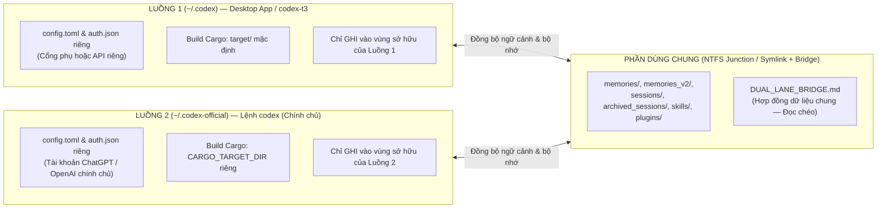

# Codex Dual-Lane & Security Kit (Windows / macOS / Linux / WSL)

> **Tác giả:** **Lê Hoàng Ngọc Tươi** | **Giấy phép:** Apache License 2.0 ([LICENSE](LICENSE) · [NOTICE](NOTICE))  
> **Bộ công cụ cài đặt 1 chạm, tự thích nghi cấu hình từng máy** giúp chạy song song **2 luồng OpenAI Codex độc lập** — tách tài khoản/API key, dùng chung bộ nhớ & lịch sử, **cách ly chỉ phân tích tĩnh (`Static-Analysis-Only`) & mặc định khóa mạng shell sandbox**, tương thích cả máy **1 ổ đĩa (`C:\`) lẫn nhiều ổ đĩa**, tự dò mọi kiểu cài đặt Codex (`WindowsApps`, `npm`, standalone), **không hardcode model/tier, không mock data, không chứa API key**.

---

## Bạn thuộc trường hợp nào? (Chọn đúng kịch bản của bạn)

| Trường hợp của bạn | Vấn đề bạn đang gặp | Bộ kit này giải quyết thế nào? |
| :--- | :--- | :--- |
| **1. Có cả tài khoản OpenAI chính chủ lẫn key/gateway bên thứ 3** | Muốn vừa dùng Desktop App (chạy key/gateway riêng) vừa dùng CLI (tài khoản ChatGPT/OpenAI chính chủ), nhưng đăng nhập bên này lại đè mất `auth.json` và `config.toml` của bên kia. | Tách 2 `CODEX_HOME` độc lập (`~/.codex` và `~/.codex-official`), sinh sẵn 2 lệnh riêng trên Terminal: **`codex`** *(chính chủ)* và **`codex-t3`** *(cổng phụ)*. |
| **2. Muốn chạy 2 agent song song trên cùng 1 dự án mà vẫn hiểu nhau** | Ví dụ: Luồng 1 làm Backend/Binary, Luồng 2 làm SAST/Frontend/CLI. Chạy chung thì đè file nhau; tách riêng thì không hiểu bên kia đang làm gì. | Nối **NTFS Directory Junction** (Windows) / **symlink** (macOS/Linux) cho `memories`, `sessions`, `skills`, `plugins` + cơ chế **Ghi riêng – Đọc chung** qua `DUAL_LANE_BRIDGE.md` *(ranh giới mềm qua prompt)* hoặc thêm cờ **`-UseGitWorktree`** *(ranh giới cứng cưỡng chế ở cấp OS sandbox qua worktree riêng)*. |
| **3. Máy chỉ có 1 ổ `C:\`, cấu hình khác nhau hoặc dùng Codex bản `npm`/standalone** | Các script cứng đường dẫn `D:\`, `E:\` hay ghi đè mất cấu hình cũ trong `config.toml` sẽ lỗi trên máy khác. | Tự dò thực tế mọi nguồn cài đặt (`WindowsApps`, `PATH`, `npm`, `-CodexPath`), tự dò feature flags bằng `codex features list`, **merge `config.toml` không phá hủy** (giữ nguyên `[mcp_servers]`, `[tui]`, `[plugins]` cũ), tự kiểm tra ổ đĩa NTFS & dung lượng trống. |
| **4. Dự án Rust bị kẹt `Blocking waiting for file lock` khi 2 agent cùng test** | Hai agent cùng chạy `cargo test` tranh nhau khóa `target/.cargo-lock`. | Tự tách `CARGO_TARGET_DIR` riêng cho Luồng 2 (mặc định `%TEMP%\codex-lane2-target`, tùy chỉnh được qua `-CargoTargetDir` nếu ổ `C:` ít dung lượng) $\rightarrow$ biên dịch song song không bao giờ khóa nhau. |
| **5. Dùng CLI từ Windows Desktop gặp lỗi `--no-daemon`, mất task ghim (`Pinned`), hoặc lo rủi ro thực thi lệnh / lộ API key** | Báo lỗi `this CLI has no complete local package`, mất danh sách `Pinned` khi DB mới chưa có dòng `threads`, hoặc lộ API key trong `config.toml`. | Tự động tắt `daemon_auto_start = false` khi có hỗ trợ, kèm `sync-sessions.py` thực hiện **UPSERT (`INSERT` + `UPDATE`)** theo schema động, dùng `env_key` để **không bao giờ lưu plaintext API key vào `config.toml`**, mặc định `approval_policy = "on-request"`, và phòng thủ 4 lớp (`workspace-write` + `network_access = false`, lọc `*KEY*/*TOKEN*`, `default.rules`, `AGENTS.md`). |

---

## Kiến trúc "2 Luồng – 1 Bộ Não Chung"



---

## Đảm bảo tương thích thực tế trên mọi cấu hình máy (Zero Mock Data)

* **Tương thích mọi bố cục ổ đĩa:** Hoạt động mượt trên cả laptop **chỉ có 1 ổ `C:\`** lẫn PC nhiều ổ (`C:\`, `D:\`, `E:\`). Tự động kiểm tra định dạng NTFS và báo cảnh báo nếu ổ build còn dưới 10 GB trống (cho phép chỉ định `-CargoTargetDir` sang bất kỳ ổ nào).
* **Tương thích mọi cách cài đặt Codex:** Tự dò theo thứ tự: `-CodexPath` $\rightarrow$ `WindowsApps` (`OpenAI.Codex`) $\rightarrow$ `PATH` *(tự loại trừ wrapper của chính nó để tránh lặp vô hạn)* $\rightarrow$ `%APPDATA%\npm\codex.cmd` / `%LOCALAPPDATA%\Programs\Codex\codex.exe`.
* **Tương thích mọi phiên bản Codex & mọi gói tài khoản:**
  * Không hardcode model hay `service_tier` vào `config.toml` trừ khi bạn truyền `-OfficialModel` / `-OfficialServiceTier` — tránh lỗi trên tài khoản không có model đó.
  * Tự chạy `codex features list` thật để chỉ bật các flag mà phiên bản Codex trên máy bạn thực sự hỗ trợ.
  * `sync-sessions.py` tự dò file `state_*.sqlite` và `goals_*.sqlite` mới nhất + đọc cột thật qua `PRAGMA table_info`, tương thích ngược/xuôi khi Codex nâng cấp database.
* **An toàn tuyệt đối khi chạy thử & cài đè:** Luôn sao lưu bản gốc có dấu thời gian (`.backup-yyyyMMdd-HHmmss`), giữ lại toàn bộ `[projects]` đã `trusted` từ trước, và hỗ trợ **`-DryRun`** để xem trước toàn bộ thao tác mà không sửa 1 byte nào trên đĩa!

---

## Cấu trúc thư mục

```text
codex-dual-lane-kit/
├── README.md                     # Hướng dẫn tổng hợp (file bạn đang đọc)
├── LICENSE                       # Giấy phép Apache License 2.0
├── NOTICE                        # Khai báo bản quyền tác giả (Apache-2.0)
├── SECURITY.md                   # Chính sách bảo mật & báo cáo lỗ hổng (tab Security trên GitHub)
├── .gitattributes                # Khóa chuẩn LF cho .sh/.py và CRLF cho .ps1/.cmd
├── .gitignore                    # Chặn không commit key / auth.json / config.toml
├── .github/workflows/ci.yml      # GitHub Actions CI tự động chạy test trên Windows & Linux
├── scripts/
│   ├── setup-dual-lane.ps1       # Bộ cài đặt tự thích nghi cho Windows 10/11 (TOML merge, snapshot SHA-256)
│   ├── setup-dual-lane.sh        # Bộ cài đặt tương đương cho macOS / Linux / WSL (hỗ trợ --dry-run)
│   ├── restore-original.ps1      # Khôi phục chính xác 1 chạm cho Windows (kiểm chứng SHA-256, gỡ Junction an toàn)
│   ├── restore-original.sh       # Khôi phục chính xác 1 chạm cho macOS / Linux / WSL
│   ├── doctor.ps1                # Chẩn đoán hệ thống & test thực thi execpolicy cho Windows (read-only)
│   ├── doctor.sh                 # Chẩn đoán hệ thống & test thực thi execpolicy cho macOS / Linux / WSL
│   └── sync-sessions.py          # Đồng bộ UPSERT (INSERT + UPDATE) phiên, Pinned & Goals
├── templates/
│   ├── default.rules             # Bộ quy tắc tiền tố lệnh (Starlark execpolicy)
│   ├── AGENTS.lane1.md           # Chỉ thị bảo vệ, phân tích tĩnh & phân luồng cho Luồng 1
│   ├── AGENTS.lane2.md           # Chỉ thị bảo vệ, phân tích tĩnh & phân luồng cho Luồng 2
│   └── DUAL_LANE_BRIDGE.md       # Mẫu cầu nối giao tiếp 2 luồng cho bất kỳ dự án nào
├── tests/
│   ├── test_sync_sessions.py     # Unit test kiểm chứng UPSERT khi DB đích trống, --pinned-only & --dry-run
│   └── test-kit.ps1              # Smoke test kiểm chứng TOML merge, env_key, UTF-8 no-BOM
└── docs/
    ├── GUIDE_AND_MANIFEST.md     # Hướng dẫn chi tiết, khai báo từng tệp/hàm/tham số & cách gỡ an toàn
    ├── REAL_CODEX_CHECKLIST.md   # Danh sách lệnh kiểm chứng thực tế trước và sau khi cài đặt
    ├── SECURITY_MODEL.md         # Mô hình phòng thủ 4 lớp, ranh giới Mềm vs Cứng (-UseGitWorktree)
    └── TROUBLESHOOTING.md        # Sổ tay xử lý 7 lỗi thực chiến hay gặp nhất
```

---

## Hướng dẫn cài đặt nhanh (Windows — 3 bước)

### Bước 0 *(Khuyên làm trước)* — Tải kho & chạy thử `-DryRun` để kiểm tra máy của bạn
Mở PowerShell và chạy (chế độ `-DryRun` không sửa bất kỳ file nào):
```powershell
git clone https://github.com/h01n9N90c/codex-cli-desktop.git
cd codex-cli-desktop
powershell -NoProfile -ExecutionPolicy Bypass -File .\scripts\setup-dual-lane.ps1 `
    -RepoPath "C:\Projects\my-app" `
    -DryRun
```

### Bước 1 — Chạy cài đặt chính thức (chọn đúng kịch bản của bạn)

#### Kịch bản A: Cài chuẩn Secure-by-Default (`approval_policy = "on-request"`, dùng model mặc định của tài khoản)
```powershell
powershell -NoProfile -ExecutionPolicy Bypass -File .\scripts\setup-dual-lane.ps1 `
    -RepoPath "C:\Projects\my-app" `
    -InstallBridgeTemplate
```
*(Nếu muốn tách thêm Git worktree riêng cho Luồng 2 để cưỡng chế phân vùng ghi ở cấp OS Sandbox, thêm cờ `-UseGitWorktree`; nếu muốn chạy tự động qua đêm không hỏi duyệt, thêm `-ApprovalPolicy never`.)*

#### Kịch bản B: Cài kèm chọn model cụ thể + đồng bộ UPSERT các phiên đã ghim (`Pinned`) từ Desktop sang CLI
```powershell
powershell -NoProfile -ExecutionPolicy Bypass -File .\scripts\setup-dual-lane.ps1 `
    -RepoPath "C:\Projects\my-app" `
    -OfficialModel "gpt-6.2-sol" `
    -SyncSessions `
    -InstallBridgeTemplate
```

#### Kịch bản C: Có thêm cổng API trung gian (bên thứ 3) cho Luồng 1 *(Không lưu key vào `config.toml` hay lịch sử lệnh)*
> **Bảo mật:** Dùng `-PromptGatewayApiKey` để nhập ẩn key vào biến môi trường User (`env_key = "CODEX_GATEWAY_API_KEY"`), tuyệt đối không ghi plaintext API key vào `config.toml` hay các file `.backup-*`:
```powershell
powershell -NoProfile -ExecutionPolicy Bypass -File .\scripts\setup-dual-lane.ps1 `
    -RepoPath "C:\Projects\my-app" `
    -ConfigureGateway `
    -GatewayBaseUrl "https://<cong-api-cua-ban>/v1" `
    -GatewayModel "<ten-model>" `
    -GatewayApiKeyEnv "CODEX_GATEWAY_API_KEY" `
    -PromptGatewayApiKey `
    -InstallBridgeTemplate
```

*(Nếu ổ `C:\` của bạn ít dung lượng trống và máy có ổ khác cho dự án Rust, thêm tham số `-CargoTargetDir "D:\codex-lane2-target"`).*

### Bước 2 — Đăng nhập tài khoản OpenAI / ChatGPT chính chủ cho Luồng 2 (1 lần duy nhất)
```powershell
codex login
codex login status   # Kỳ vọng: Logged in using ChatGPT
```

### Bước 3 — Kiểm tra sức khỏe toàn hệ thống bằng `doctor.ps1` & bắt đầu chạy
```powershell
powershell -NoProfile -ExecutionPolicy Bypass -File .\scripts\doctor.ps1
```
Sau khi toàn bộ mục báo `[PASS]`:
* **Luồng 1:** Mở **Codex Desktop App** *(hoặc gõ `codex-t3` trên Terminal)*.
* **Luồng 2 (Chính chủ):** Mở PowerShell trong thư mục dự án và gõ `codex` *(hoặc `codex resume` để mở lại phiên đã ghim)*.

---

## Người dùng macOS / Linux / WSL
```bash
git clone https://github.com/h01n9N90c/codex-cli-desktop.git
cd codex-cli-desktop
chmod +x ./scripts/setup-dual-lane.sh ./scripts/doctor.sh
./scripts/setup-dual-lane.sh --repo /path/to/your-project --dry-run
./scripts/setup-dual-lane.sh --repo /path/to/your-project --install-bridge
./scripts/doctor.sh
codex login
codex
```

---

## Sổ tay lệnh nhanh hàng ngày

| Mục đích | Lệnh |
| :--- | :--- |
| Chẩn đoán cấu hình máy & chạy probe thực thi `execpolicy` | `powershell -NoProfile -ExecutionPolicy Bypass -File .\scripts\doctor.ps1` |
| Xem trước khôi phục chính xác về trạng thái gốc (`-DryRun`) | `powershell -NoProfile -ExecutionPolicy Bypass -File .\scripts\restore-original.ps1 -DryRun` |
| Khôi phục chính xác 100% về trạng thái trước khi cài (kèm kiểm chứng SHA-256) | `powershell -NoProfile -ExecutionPolicy Bypass -File .\scripts\restore-original.ps1` |
| Chạy toàn bộ Unit Test, Smoke Test & Rollback Test của bộ kit | `powershell -NoProfile -ExecutionPolicy Bypass -File .\tests\test-kit.ps1` |
| Chạy Codex CLI bằng **tài khoản OpenAI chính chủ (Luồng 2)** | `codex` *(hoặc `codex-official`)* |
| Chạy Codex CLI bằng **cấu hình Desktop / Gateway (Luồng 1)** | `codex-t3` |
| Đổi model ngay trong khung chat TUI | Gõ `/model` |
| Mở CLI với một model cụ thể | `codex -m <model-slug>` |
| Mở lại phiên cũ / phiên đã ghim | `codex resume` *(hoặc `codex resume --all`)* |
| Đồng bộ UPSERT lại phiên mới ghim từ Desktop sang CLI | `python .\scripts\sync-sessions.py --repo "C:\Projects\my-app" --pinned-only` |
| Chỉnh chế độ hỏi duyệt ngay trong phiên đang mở | Gõ `/permissions` |
| Gặp giới hạn 100 request/phiên từ cổng trung gian | Gõ `/new` *(code trên đĩa còn nguyên, không bấm Hoàn tác)* |

---

## Tài liệu chi tiết đi kèm
* 📘 **[Hướng dẫn Chi tiết & Khai báo Mã nguồn / Công cụ (Manifest)](docs/GUIDE_AND_MANIFEST.md)** — Khai báo minh bạch từng tệp, từng hàm mã nguồn, đường dẫn đọc/ghi, toàn bộ bảng tham số CLI và hướng dẫn gỡ bỏ an toàn.
* ✅ **[Danh sách Kiểm chứng Thực tế (Real Codex Verification Checklist)](docs/REAL_CODEX_CHECKLIST.md)** — Các lệnh thực nghiệm để tự kiểm tra không lộ key, probe `execpolicy`, merge TOML và test UPSERT SQLite.
* 🛡️ **[Mô hình Phòng thủ 4 Lớp, Ranh giới Mềm vs Cứng & Khiên Git](docs/SECURITY_MODEL.md)**
* 🔧 **[Cẩm nang Xử lý 7 Lỗi Thực Chiến](docs/TROUBLESHOOTING.md)**

---

## Tác giả & Bản quyền
* **Tác giả:** **Lê Hoàng Ngọc Tươi**
* **Bản quyền & Giấy phép:** Phát hành theo giấy phép mã nguồn mở **[Apache License 2.0](LICENSE)** (`Copyright 2026 Lê Hoàng Ngọc Tươi` — xem thêm [NOTICE](NOTICE)). Mọi người có thể tự do sử dụng, sửa đổi và phân phối lại theo điều khoản Apache-2.0 với điều kiện giữ nguyên tệp `LICENSE` và thông báo bản quyền `NOTICE`.
